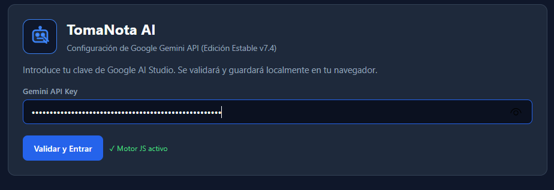
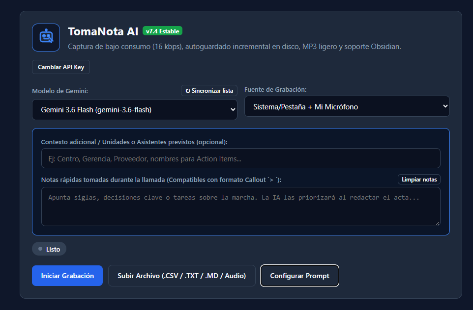
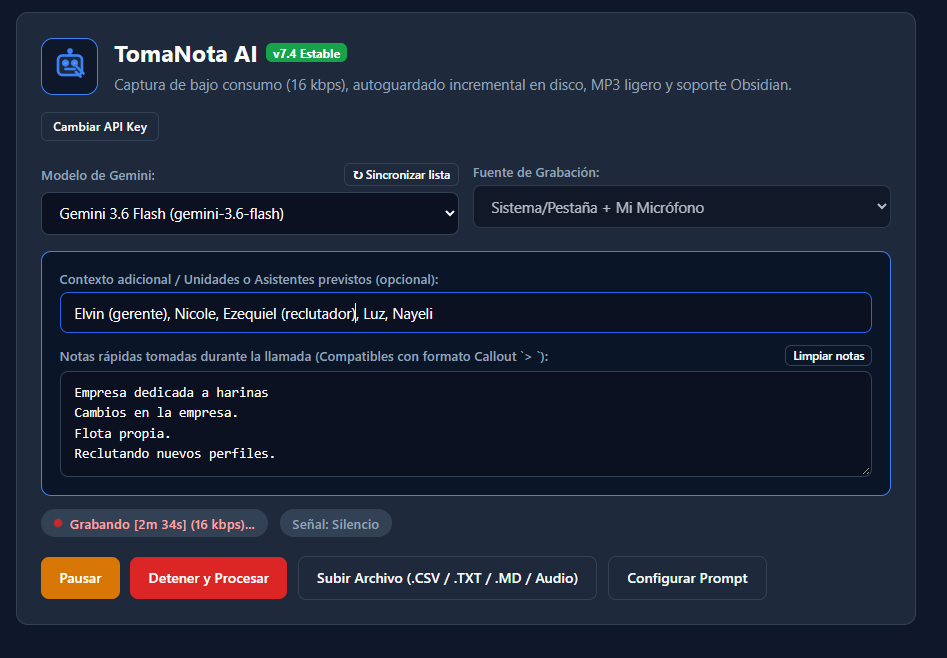
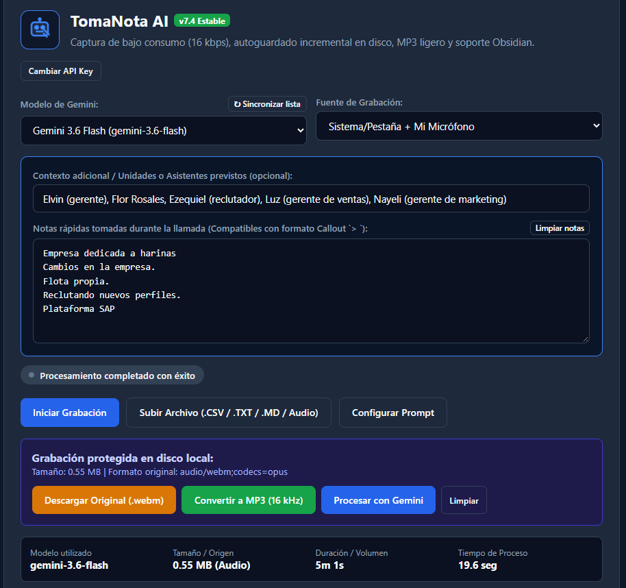
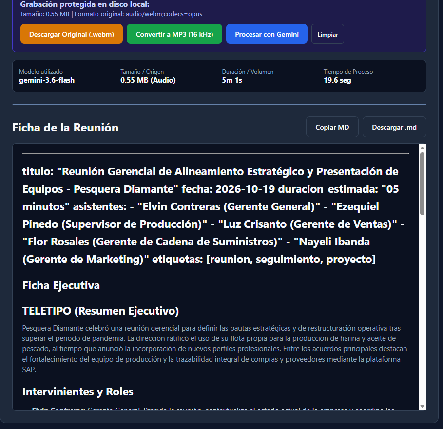

# 📝 TomaNota AI

🚀 **[Abrir TomaNota AI en el navegador (GitHub Pages)](https://canariasmedcalc/tomanota-ai/)** | 📦 **[Descargar versión offline (.ZIP)](https://github.com/olivercabello/tomanota-ai/archive/refs/heads/main.zip)**

Aplicación web en un único archivo HTML para grabar, transcribir y generar actas de reuniones mediante la API de Google Gemini. Funciona 100% en local desde el navegador, sin servidores intermedios ni bots en las salas de videoconferencia.

Desarrollado por **Oliver Cabello** y **Alejandro Jara**.

---

## 📸 Capturas de pantalla

### Vista Principal y Configuración


### Flujo de Trabajo y Resultados
| Grabación y Notas en Directo | Selección y Carga de Archivos |
| :---: | :---: |
|  |  |

| Personalización de Prompts (Obsidian / YAML) | Acta Generada y Exportación MP3/MD |
| :---: | :---: |
|  |  |

---

## Características

- **Captura de audio de bajo consumo:** Graba simultáneamente el audio de la llamada (sistema/pestaña) y el micrófono en formato Opus mono a 16 kHz y 16 kbps (~6.8 MB/hora). Limita la pista de vídeo requerida por el navegador a 1 FPS (320x240) para no penalizar la CPU en equipos de oficina.
- **Autoguardado incremental en disco (IndexedDB):** Escribe cada fragmento de 5 segundos directamente en la base de datos local del navegador. Si la pestaña se cierra por accidente o el equipo se bloquea, la grabación se recupera al volver a abrir el archivo.
- **Notas en directo y contexto:** Permite anotar acuerdos, siglas o unidades implicadas durante la reunión para que el modelo los priorice en el acta.
- **Entrada multimodal:** Procesa tanto grabaciones en vivo como archivos externos de audio (`.webm`, `.mp3`, `.wav`, `.m4a`, `.ogg`) y transcripciones de texto plano (`.csv` de LiveCaptions, `.txt`, `.md`).
- **Prompts y modelos persistentes:** Sincroniza automáticamente la lista de modelos disponibles en tu cuenta de Google AI (`gemini-2.5-flash`, `gemini-2.5-pro`, etc.). Incluye plantillas predefinidas para **Obsidian Callout** (`> [!NOTE]`) y **Markdown con YAML frontmatter**, guardando tus preferencias en el navegador.
- **Exportación directa:** Descarga el acta en `.md` y el audio en su formato nativo (`.webm`) o convertido localmente a `.mp3`.

---

## Stack técnico

- **Frontend:** HTML5, CSS3 y JavaScript Vanilla (ES6+).
- **APIs nativas:** Web Audio API (`DynamicsCompressor`, `AnalyserNode`), MediaRecorder API, IndexedDB y Web Storage.
- **Librerías externas (vía CDN):**
  - [Marked.js](https://marked.js.org/) — Renderizado de Markdown en pantalla.
  - [Lame.js](https://github.com/akrennmair/lamejs) — Codificación a MP3 a 16 kHz en el cliente.
- **IA:** Google Gemini REST API (`generateContent` y `Files API` para archivos mayores de 14.5 MB).

---

## Puesta en marcha y uso

No requiere instalación de entornos de desarrollo, servidor web dedicado ni dependencias de Node.js.

1. Clona el repositorio o descarga el archivo `index.html`:
   ```bash
   git clone [https://github.com/tu-usuario/tomanota-ai.git](https://github.com/tu-usuario/tomanota-ai.git)

2. Abre el archivo .html en cualquier navegador basado en Chromium (Google Chrome, Microsoft Edge, Brave).
3. Introduce tu clave de Google AI Studio (https://aistudio.google.com/). La clave quedará guardada en el almacenamiento local de tu navegador.
4. Selecciona la fuente de grabación, pulsa Iniciar Grabación y asegúrate de activar la casilla "Compartir audio de la pestaña / del sistema" en la ventana del navegador.

---

## Nota

Para reuniones muy largas cuyo audio supere los 14.5 MB, la Files API de Google requiere que la página se sirva bajo protocolo HTTP (no file://). Basta con levantar un servidor estático rápido en la carpeta:
   ```bash
   python -m http.server 8000

````

---
## Privacidad y aviso legal

- Esta herramienta ejecuta la captura en tu propio navegador y se comunica directamente con la API oficial de Google Gemini usando tu clave personal. Los autores no recopilan, almacenan ni tienen acceso a las grabaciones, transcripciones o claves utilizadas. Asegúrate de contar con el consentimiento de los participantes antes de grabar cualquier sesión.

---

## Licencia

- Esta herramienta ejecuta la captura en tu propio navegador y se comunica directamente con la API oficial de Google Gemini usando tu clave personal. Los autores no recopilan, almacenan ni tienen acceso a las grabaciones, transcripciones o claves utilizadas. Asegúrate de contar con el consentimiento de los participantes antes de grabar cualquier sesión.
